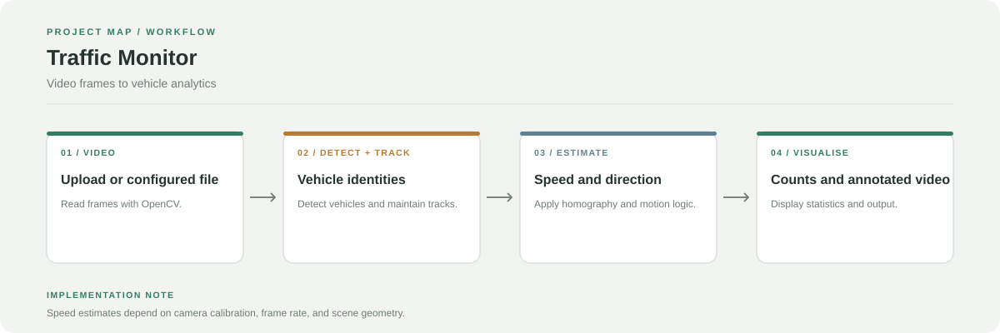

# Traffic Monitor

A computer-vision pipeline for vehicle detection, tracking, speed estimation, direction detection, and traffic counting from video. It includes a Streamlit dashboard and a script-driven processing entry point.

**Stack:** Python, OpenCV, NumPy, modular detection/tracking and traffic-analysis components



## Processing flow

1. Read frames from an uploaded video in Streamlit or the configured input video.
2. Detect vehicles and associate detections with tracked objects.
3. Transform image coordinates using homography and estimate speed and direction.
4. Count traffic, draw overlays, and report directional statistics.

## Main components

- `streamlit_app.py`: interactive video processing and statistics
- `app.py`: script-oriented processing pipeline
- `src/core/`: detector and tracker
- `src/logic/`: homography, speed, direction, and counting logic
- `src/ui/`: visualisation
- `src/config.py`: processing configuration

## Run the dashboard

```bash
git clone https://github.com/chyk2468/Traffic-Monitor.git
cd Traffic-Monitor
python -m venv .venv
```

Activate the environment, then install dependencies and launch:

```bash
pip install -r requirements.txt
streamlit run streamlit_app.py
```

Check `src/config.py` and the sidebar controls for video and speed-limit settings.

## Calibration and limitations

Speed estimates require an appropriate relationship between image coordinates and real-world distances. Camera perspective, frame rate, occlusion, and detection errors affect accuracy. Calibrate and validate the system for the intended camera before using the results operationally.
