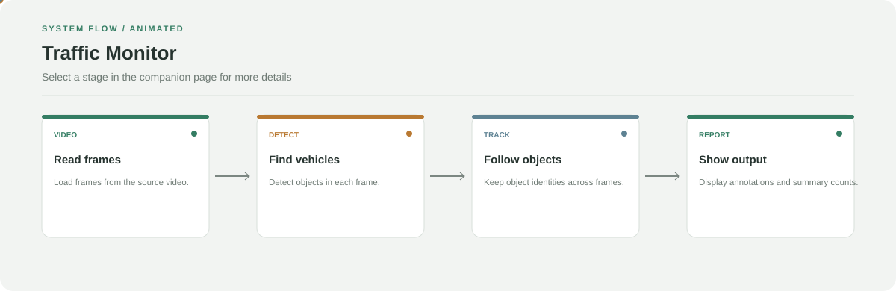

# Traffic Monitor

**Detect, track, count, and estimate vehicle motion from video.**

[](https://github.com/chyk2468/Traffic-Monitor)

## 1. Project Title & Tagline

Detect, track, count, and estimate vehicle motion from video.

## 2. Problem Statement

Traffic footage is difficult to count and analyse manually at scale. This project combines vehicle detection and tracking with motion estimation to produce annotated video and traffic statistics.

## 3. Project Preview

Add a screenshot or short GIF showing a representative input, prediction, and explanation or visual output.

[Open interactive architecture](architecture.html)

## 4. Overview

The pipeline prepares input data, applies the configured model or processing logic, and presents outputs for review. The workflow diagram summarises the main stages.

## 5. Key Features

- Read uploaded or configured video.
- Detect and track vehicles across frames.
- Estimate speed and direction using configured geometry.
- Display counts and annotated output.

## 6. Architecture / Workflow



Open the [interactive architecture explorer](architecture.html) to select a stage and inspect its role.

## 7. Tech Stack

Python, OpenCV, NumPy, vehicle detection/tracking modules, Streamlit

## 8. Installation & Setup

```bash
git clone https://github.com/chyk2468/Traffic-Monitor.git
cd Traffic-Monitor
python -m venv .venv
pip install -r requirements.txt
```

## 9. Usage

Run `streamlit run streamlit_app.py` for the dashboard, or use the script entry point documented in the repository. Configure the input video and review speed calibration before interpreting measurements.

## 10. Project Structure

- `streamlit_app.py`: interactive dashboard
- `app.py`: script-oriented processing
- `src/core/`: detector and tracker
- `src/logic/`: homography, speed, direction, and counting
- `src/ui/`: visualisation
- `src/config.py`: configuration

## 11. Results & Demo

Add an annotated-video GIF and report detection/tracking quality on labelled footage. Speed estimates require calibration for the specific camera.

## 12. Future Enhancements

- Add calibration checks and setup guidance.
- Export per-frame and per-track statistics.
- Measure detector/tracker performance.
- Test crowded scenes and occlusions.

## 13. License

Check the code and model licences before redistribution.
